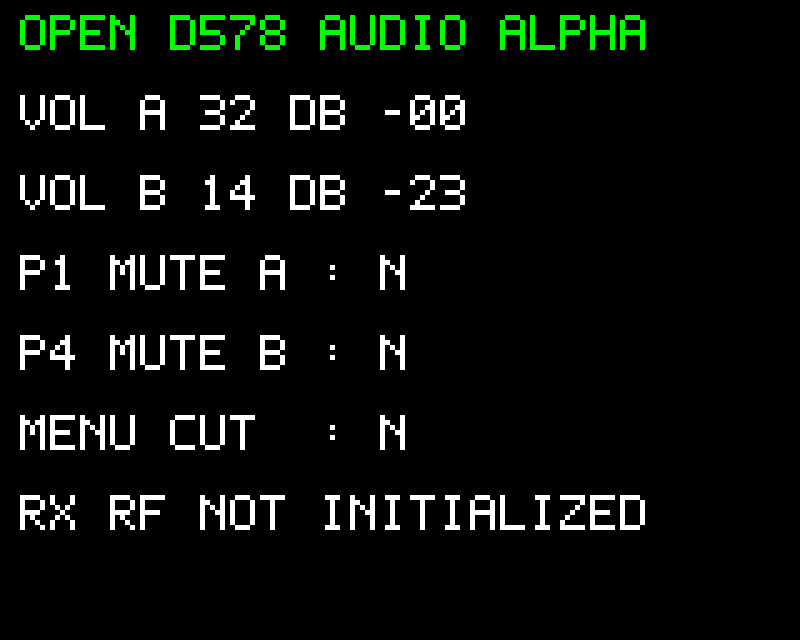

# OpenD578 — programme audio alpha indépendant

Jean-Philippe (F4EGM), 9 novembre 2026.

Ce programme C exécute les premiers contrats audio OpenD578 sur Cortex-M4. Il utilise les GPIO et périphériques du GD32 ; il n’appelle aucune routine OEM et ne fabrique pas son écran depuis JavaScript. Son binaire démarre à `0x08006000`, SRAM 96 Kio, pile à `0x20018000`.

**Périmètre livré : programme de contrôle qualifié dans le banc ARM. Ce n’est pas un firmware radio complet, ni une image de mise à jour constructeur qualifiée pour le poste.** La chaîne RF n’est pas initialisée et aucune réception FM n’est annoncée. Les tests d’écoute sur matériel viendront avec la phase de portage correspondante.

## Essai dans le navigateur

Le bouton **Essayer le programme audio alpha** charge le binaire fourni sans sauvegarde OEM. L’ARM lit les entrées, génère les mots série et dessine le texte par les strobes du bus LCD.

| Commande | Réaction du programme |
|---|---|
| Potentiomètre A, PC2 / ADC12 | Niveau 0…32 → U2429 canal 1 |
| Potentiomètre B, PC5 / ADC15 | Niveau 0…32 → U2429 canal 2 |
| P1 | Bascule la coupure du canal 1 |
| P4 | Bascule la coupure du canal 2 |
| MENU | Coupe les deux volumes et positionne PA7 à 1 |
| EXIT | Rouvre les deux volumes et positionne PA7 à 0 |

Le LCD affiche les niveaux et les atténuations nominales. `DB CUT` désigne la coupure ; les autres valeurs sont les atténuations nominales du U2429. Les niveaux et codes sont produits par `firmware/hal/audio_control.c`, déjà comparé aux fonctions OEM isolées sur 62 402 cas.

Pour écouter l’action des commandes dans le banc : après démarrage, ouvrir **Audio · traversée de l’atténuateur U2429**, charger un WAV sur les ports choisis, exécuter le CPU et agir sur les volumes. L’export contient les sorties du composant. Le fichier WAV est une source externe d’essai, pas une réception RF simulée.

## Ce que l’expérience établit

ADC/DMA → quantification C → mots GPIO PA13/PA14 → latch U2429 → variation des échantillons ; touches → coupures ; programme → bus LCD → pixels. Le test ARM vérifie que les autres canaux sont conservés, qu’un appui maintenu ne répète pas la bascule et que EXIT restaure le niveau des potentiomètres.

La sélection HP micro par RF 0x25 bit 4 n’est pas exécutée dans cette version ; elle nécessite le contexte d’initialisation RF. Les broches des volumes partagent PA13/PA14 avec SWD : ce programme les libère pour les utiliser comme le fait l’OEM. Cela devra être intégré à la procédure de mise au point matérielle ; ne pas traiter ce binaire de banc comme un paquet CPS prêt à installer.

L’alpha maintient PE6 et PC4 bas, PA4 en entrée analogique et les quatre sélections RF inactives. Elle n’écrit ni registres RF, ni NAND, ni contrôleur Flash. Ces propriétés sont vérifiées pour le scénario exécuté dans le banc ; aucune validation électrique sur poste n’est revendiquée.

## Construction

```bash
python3 tools/build_audio_alpha.py --zig /chemin/zig
node --test browser-bench/tests/audio-alpha.test.mjs
```

Build vérifié avec Zig 0.14.1, Cortex-M4 Thumb, soft-float. Le script produit `audio_alpha.elf`, `audio_alpha.bin`, puis copie les binaires dans les exemples du banc. `build.json` donne la taille et le SHA-256.

La version actuelle est volontairement courte : pas de RTOS, pas de décodage DMR, pas de copie de firmware OEM. L’étape suivante est le contexte d’initialisation RX, puis le test de sélection des HP sur matériel. Le modèle acoustique précis n’est pas un prérequis à cette progression fonctionnelle.

## Écran produit par le programme



Le rendu vient des pixels émis sur GPIO dans le scénario de contrôle ; ce n’est pas une photographie du poste réel. `tools/verify_audio_alpha.mjs` reconstruit les données RGBA et le rapport de démarrage.

Le programme attend les interruptions SysTick entre acquisitions de contrôle, au lieu de tourner en attente active. La cadence utilise le temps virtuel 120 M unités/s du banc ; le rechargement SysTick devra être adapté au profil d’horloge retenu lors du portage matériel.

Après l’écran initial, seuls les bandeaux modifiés sont redessinés : un changement de volume actualise 2560 pixels au lieu de 20 480 pour un écran complet. Cette propriété est vérifiée dans le test ARM.
