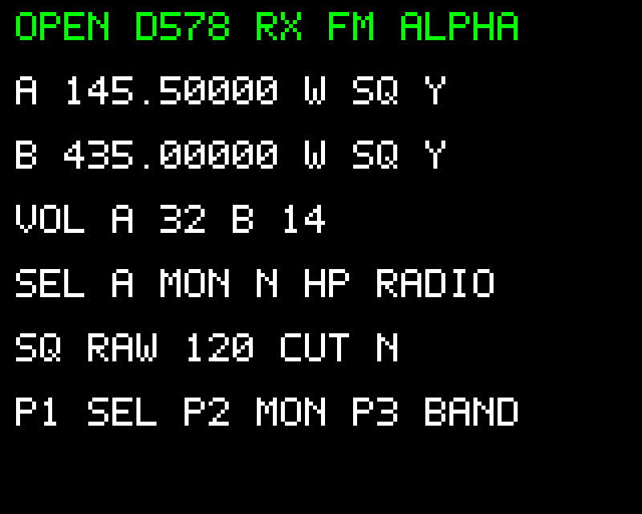

# OpenD578 — réception FM alpha

Jean-Philippe (F4EGM), 9 novembre 2026.

Ce programme ARM indépendant initialise les quatre banques RF et commande deux voies de réception FM. Il acquiert les touches et volumes par ADC/DMA, lit les détecteurs RF par SDIO, décide du squelch, commande les volumes U2429, les sorties HP et le voyant vert, puis dessine son écran par le bus LCD. Il n'appelle aucune fonction OEM et n'utilise aucune variable SRAM de l'application constructeur.

**Livraison : programme de commandes RX vérifié dans le banc, pas encore une réception FM validée sur le poste.** L'émulateur ne démodule pas un signal RF. Les entrées de détecteurs et WAV restent des sources d'essai explicites. Le binaire brut n'est pas un paquet CPS à installer.

## Essayer

Dans le simulateur Web, cliquer sur **Essayer la réception FM alpha**. Aucune sauvegarde OEM n'est nécessaire. Les fréquences initiales sont A = 145,500 MHz et B = 435,000 MHz.

| Commande de façade | Action |
|---|---|
| P1 | Sélectionne A ou B pour le codeur et les réglages |
| Codeur | Pas de 12,5 kHz sur la voie sélectionnée |
| P2 | Bascule le moniteur : ouvre l'audio sans demander de porteuse |
| P3 | Bascule la voie sélectionnée entre 145,500 et 435,000 MHz |
| P4 | HP Radio → Both → Mic → Radio |
| P5 | Large / étroit sur la voie sélectionnée |
| P6 | Seuil brut 120 → 140 → 80 → 100 → 120 |
| MENU / EXIT | Coupe / restaure l'audio |
| Potentiomètres A / B | Volumes indépendants ; une voie au squelch fermé reste coupée |

La limite du codeur est 136–174 MHz ou 400–480 MHz dans ce profil d'essai. Les touches Power et du microphone ne sont pas interprétées par cette expérience ; le protocole OEM du microphone reste disponible avec le firmware OEM dans le même banc. Le programme ne possède aucun traitement TX.

Pour vérifier le squelch : dans les entrées RF brutes du banc, choisir la banque 0 ou 1, mettre le registre `0x0C` à **2**, puis appliquer. Après trois lectures, la voie s'ouvre. Pour la fermer, appliquer `0x0C=0`, `0x65=127`, `0x67=0`. Le voyant vert suit l'ouverture logique ; le rouge reste éteint.

Pour écouter les changements de volume, charger un WAV dans la section **Audio · traversée de l'atténuateur U2429**, puis utiliser P2 ou les détecteurs ci-dessus. IN1 et IN2 sont les ports du composant : cela vérifie les commandes et l'atténuation, sans présenter le WAV comme une réception démodulée ni les sorties du composant comme un modèle complet des HP.

## Commandes RF portées

| Fonction | Référence d'analyse OEM | Réécriture |
|---|---|---|
| Reset et paramètres des quatre banques | `0x080723E6`, sous-routines incluses | `d578_rx_reset`, 225 opérations, dont 4 attentes de 20 ms et 2 lectures |
| Mode réception analogique et filtres | `0x0806E84A`, branche 0 | `d578_rx_fm_mode` ; 0x44 = 0x43EC, 0x7E = 0x342E dans ce profil |
| Préparation et activation RX | `0x0806E5B2`, `0x0806E4BA`, `0x0806DD92`, `0x0806D06A` | `d578_rx_begin` et `d578_rx_start` |
| Plan de fréquence et gamme synthèse | `0x0806E3F0`, `0x0806E134` | `d578_rx_tune` ; deux banques par voie |
| Seuil brut de détection | `0x0806D1CC` | `d578_rx_threshold`, reg. 0x4F puis 0x78 |
| Décision de squelch analogique | `0x0808F932` | `d578_rx_squelch_update` |
| Volumes et modes des HP | Routines déjà comparées, voir le contrat audio | `firmware/hal/audio_control.c`, raccordé au GPIO |

La voie A commande les banques 0 et 2 ; la voie B commande les banques 1 et 3. La banque 0 reçoit une fréquence intermédiaire de 38,85 MHz ; la banque 1, 38,55 MHz. Pour les plages VHF de l'expérience, les banques 2/3 reçoivent respectivement F + 38,85 / F + 38,55 MHz. En UHF, elles reçoivent F − 38,85 / F − 38,55 MHz. Toutes les fréquences utilisent les mots 0x38 bas / 0x39 haut, en unités de 10 Hz. Les quatre registres de gamme associés sont aussi écrits ; la paire de fréquence seule ne suffit pas.

Ces rôles sont établis au niveau des commandes OEM. Ils n'attribuent pas un numéro de boîtier sur une photographie et ne constituent pas une mesure de verrouillage PLL.

La routine de squelch utilise le bit 1 de 0x0C. Elle ouvre après trois lectures favorables. À la fermeture, elle examine aussi `0x65 & 127` et `0x67 & 511`, avec seuil de bruit 43 et seuil brut fourni. Particularité conservée : un bon échantillon de repli ne remet pas à zéro un compteur de fermeture déjà commencé. Ce sont des nombres de lectures, pas une temporisation OEM transposée en millisecondes. L'alpha choisit une cadence de lecture de 10 ms.

## Paramètres propres au poste

**Le seuil initial 120 est un paramètre d'essai affiché à l'écran. Il ne provient pas de la NAND et n'est pas une calibration usine inventée.** Le chargement indépendant des courbes et trims propres au poste reste à raccorder. Le profil garde un choix explicite d'indice de gain RX 0 et désactive les contextes auxiliaires ; il ne prétend pas reproduire tous les modes de double veille de l'OEM. Les codes QA ne sont pas convertis en dB acoustiques.

L'horloge est initialisée par le programme : HXTAL 12 MHz, PLL ×10, HCLK 120 MHz, APB1 60 MHz, APB2 120 MHz ; ADC /8 = 15 MHz. Les champs PLL et la latence Flash reprennent la séquence comprise dans `0x08006260`, avec des attentes bornées. Le LCD reçoit un reset et des attentes après reset/sortie de veille. Les entrées analogiques utilisent le temps d'échantillonnage long. Le banc vérifie les états de registres ; il ne mesure pas les fréquences ni les fronts sur une carte.

Les sorties PE6/PC4 restent basses ; PA4 reste en entrée analogique. Les essais surveillent leurs commandes pendant l'exécution, y compris avec une demande PTT du microphone. Aucun accès NAND ou écriture Flash n'est ajouté. La libération de SWJ pour PA13/PA14, nécessaire aux volumes, reste une contrainte de la procédure de développement matériel.

## Vérifications reproductibles

```bash
python3 tools/build_rx_fm_alpha.py --zig /chemin/vers/zig
cc -std=c11 -Wall -Wextra -Werror -pedantic firmware/rf/rx_fm.c firmware/tests/test_rx_fm.c -o /tmp/test_rx_fm
/tmp/test_rx_fm
node --test browser-bench/tests/rx-fm-alpha.test.mjs
python3 tools/verify_rx_fm_oem.py /chemin/full_flash_pass1.bin --output /tmp/rx_fm_differential.json
node tools/verify_rx_fm_alpha.mjs
```

**Résultat : 20 585 comparaisons sans différence** (18 884 fréquences, 1 152 états de squelch, 512 seuils, 32 préparations/activations, quatre profils de filtre et une initialisation).

Le test différentiel exige Python Unicorn et le compilateur C. La Flash de référence doit avoir le SHA-256 `e2f2483baf60e2bfcab656e25e949670713222591ef4d611d6089054819a750e`. Il exécute des routines isolées avec des entrées de test déclarées, pas un démarrage complet OEM. Le test Node exécute le nouveau binaire ARM : commandes de bus, fréquences, codeur des deux voies, filtres, squelch, modes HP, volumes, LED et inhibition TX.

Les résultats sont dans [la preuve différentielle](../../../docs/evidence/rx_fm_alpha/differential.json) et [le rapport ARM](../../../docs/evidence/rx_fm_alpha/boot.json). `build.json` donne la taille et l'empreinte du binaire fourni. Les tables contiennent des paramètres de registres ; aucun morceau de programme OEM n'est embarqué.



## Validation matérielle restante

La prochaine étape est de raccorder le chargement des trims et courbes NAND, puis de préparer une image de test matériel et sa procédure de récupération. La sensibilité, le verrouillage RF, l'audio aux HP et le comportement des prises externes doivent être vérifiés sur le poste. CTCSS/DCS, scan, mémoire CPS et microphone complet ne sont pas intégrés dans cette expérience autonome ; leurs travaux précédents restent dans le banc OEM. DMR et émission restent différés.
